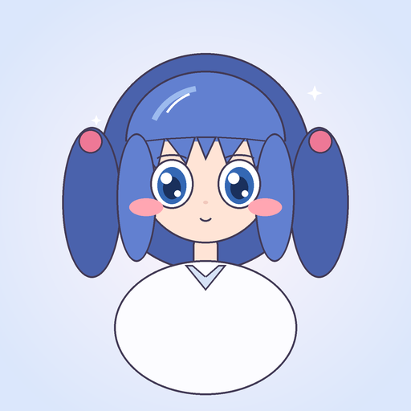
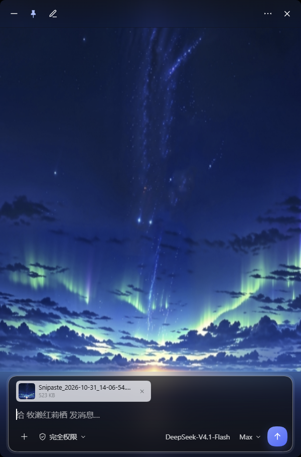
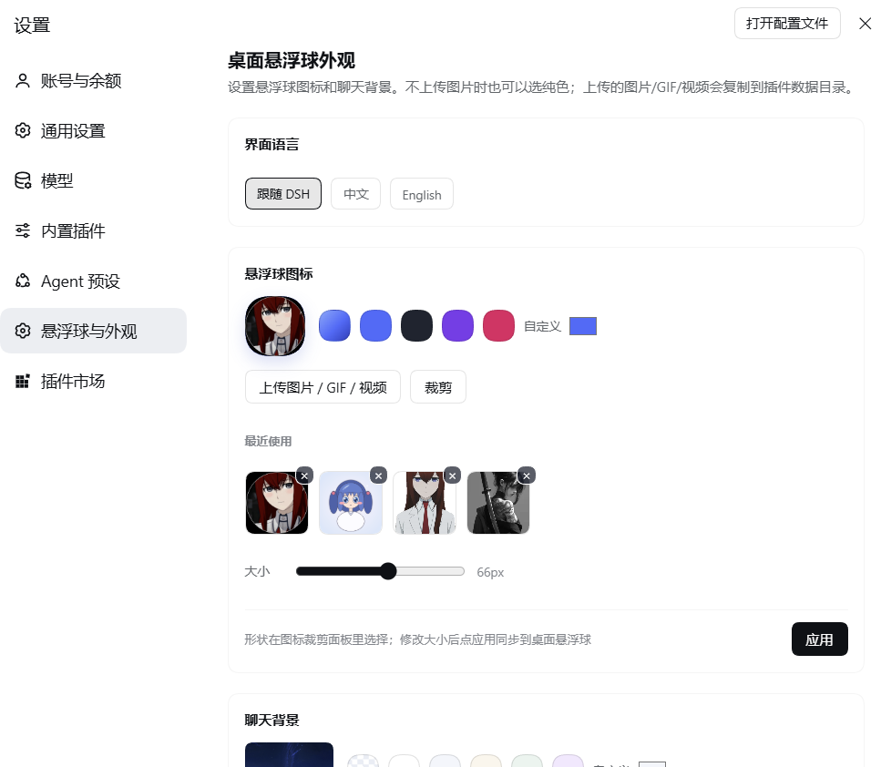
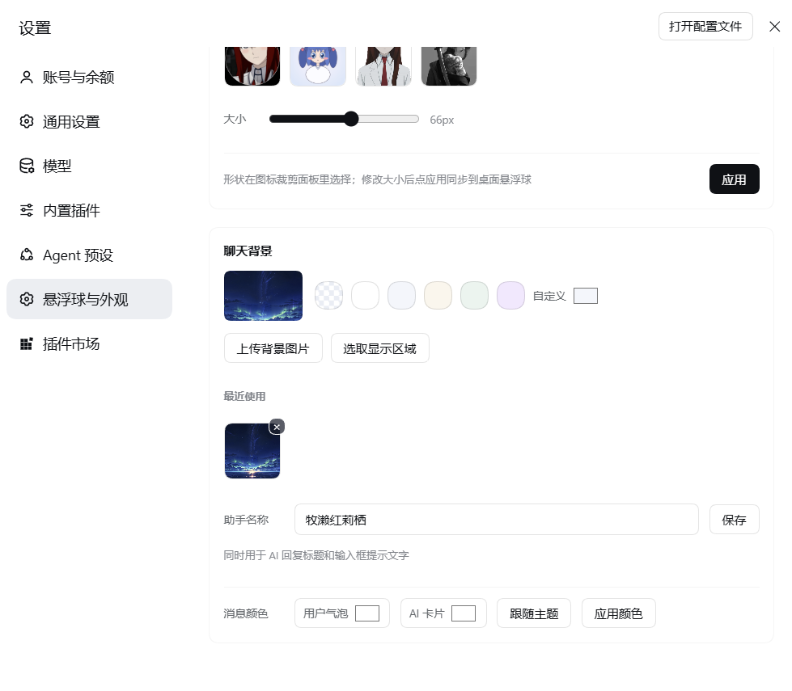

<div align="center">

<h1>桌面悬浮球</h1>
<p><b>给 DeepSeek Harness 加一颗可自定义 图标和背景 的桌面悬浮球：点一下，在独立窗口里对话。</b></p>
<p>
<a href="#兼容性"></a>
<a href="#兼容性"></a>
<a href="LICENSE"></a>
</p>
<p>
<a href="#安装">安装</a> ·
<a href="#使用">使用</a> ·
<a href="#外观">外观</a> ·
<a href="#原理">原理</a> ·
<a href="#排查">排查</a> ·
<a href="docs/appearance.md">设置</a> ·
<a href="docs/architecture.md">架构</a>
</p>
</div>


| 桌面悬浮球 | 点开就是完整对话 |
| :--: | :--: |
|  |  |

## 这是什么

**桌面悬浮球**（Desktop Floating Ball / `dsh-desktop-ball`）是一个 DeepSeek Harness 插件。它在 Windows 桌面上放一颗透明、置顶的小球，点一下就在独立窗口里打开 DSH 对话，不用切回主窗口。

如果你常常只是「想问一句就走」，它省掉的就是找窗口、还原窗口、再关掉窗口的那几步。

三个关键取舍：

- **不是主窗口的最小化版**：小球是独立的系统级窗口，DSH 最小化、甚至主窗口在后台，它都还在。
- **不是浏览器窗口**：聊天窗口内嵌 WebView2，没有地址栏、标签页、Edge 图标和翻译提示条。
- **不碰 DSH 本体**：不修改 `app.asar`、不注入 Electron 主进程，升级 DSH 后插件可以独立保留。

## 特性

- 🖱️ **单击开窗，双击隐藏**：隐藏只收起窗口，WebView 和当前对话都保留，再点一下立即恢复，不会重新初始化。
- 🎨 **外观全可换**：图标（图片 / GIF / 视频 / 纯色）、裁剪、形状、大小、聊天背景区域、消息颜色、助手名称。
- ⚡ **预热**：鼠标移到球上，窗口已在屏幕外开始加载；点击时通常已经加载完成。
- 🧠 **输入区与主界面一致**：模型、权限、推理等级、关闭思考，图片 / 附件上传、拖拽与剪贴板粘贴截图，流式回复与停止。细节见 [输入区](docs/composer.md)。
- 🌐 **界面语言**：跟随 DSH / 中文 / English，只影响插件页面与快捷窗口文案。
- ✅ **提问和审批不出窗**：`ask_user_question` 卡片与 `approval/request` 都能在小窗内处理，主窗口和快捷窗口谁先响应谁生效。
- 🪟 **自动回退**：缺少 WebView2 时退回 Edge / Chrome `--app` 窗口；macOS / Linux / 浏览器用 `Alt + Q` 打开应用内面板。

## 安装

要求：Windows 10/11 + DSH Desktop（`dsh >= 0.2.1-rc.2 < 0.3.0`）。

### 方式 A：从插件页安装（推荐）

1. 打开 DSH Desktop，侧边栏进入 **Plugins / 插件**。
2. 选择从本地路径安装，填入本目录的绝对路径。
3. 启用 `dsh-desktop-ball` 组合包，按提示重启应用。
4. 重启后桌面右下角出现悬浮球，DSH 侧边栏不会再添加旧入口。

### 方式 B：用 CLI 安装

在包目录下执行：

```sh
dsh plugin --profile desktop add .
```

`desktop` 是桌面版占用的 profile 名。命令会把本目录以 `link:` 方式写入 profile，并把 `dsh-desktop-ball` 追加到 `dsh.profile.bundles`。

只检查配置层、不启动：

```sh
dsh --profile desktop --dump-config
```

输出中应出现 `id: quick-chat` 与 `name: dsh-desktop-ball`。

### 方式 C：手动加入 profile（进阶）

插件页安装不可用时：

1. 完全退出 DSH Desktop。
2. 用 DSH 自带的 pnpm 把目录链接进 profile：

   ```powershell
   $node = "$env:USERPROFILE\.dsh\dsh-runtimes\dsh-primary-runtime\dependencies\node\bin\node.exe"
   $pnpm = "$env:USERPROFILE\.dsh\dsh-runtimes\dsh-primary-runtime\dependencies\pnpm\bin\pnpm.cjs"
   & $node $pnpm add "link:<本目录绝对路径>" --dir "$env:USERPROFILE\.dsh\profiles\desktop"
   ```

3. 打开 `%USERPROFILE%\.dsh\profiles\desktop\package.json`，在 `dsh.profile.bundles` 数组末尾加入 `"dsh-desktop-ball"`。
4. 重新打开 DSH Desktop。

改 profile 前先备份 `package.json`；不确定时优先用方式 A。

## 使用

| 操作 | 效果 |
| --- | --- |
| 点悬浮球 | 打开 / 置顶桌面聊天窗口 |
| 双击悬浮球 | 隐藏聊天窗口（保留 WebView 与对话） |
| 拖动悬浮球 | 移动并记忆位置；距屏幕边缘 26px 内松手会吸附，留 4px 缝隙 |
| 拖动窗口任意边 / 四角 | 缩放聊天窗口，最小 360×480，尺寸自动记忆 |
| 窗口顶栏 `—` / 图钉 / 新建 / `⋯` / `✕` | 最小化到球 / 切换置顶 / 打开新对话 / 更多菜单 / 关闭窗口 |
| `Alt + Q` | 在主界面内展开 / 收起应用内面板 |
| `Enter` / `Shift + Enter` | 发送 / 换行 |
| 运行中的方块按钮 | 停止当前生成 |
| `Esc` | 先关菜单，再收起应用内面板 |

快捷窗口使用独立的 DSH 会话：它会出现在侧边栏，也能在完整界面继续。新建的会话统一归入名为 `ChatWindow` 的工作区，没有该工作区时会在当前工作区旁自动创建并注册。

DSH 侧边栏不再注册「快捷对话」入口：桌面入口只有悬浮球，应用内入口是 `Alt + Q`。

## 外观

两个入口：**右键悬浮球**快速换图标 / 背景，或 **DSH 设置 →「悬浮球与外观」**集中管理。

悬浮球可以是图片、GIF、视频或纯色球，聊天窗口可以换背景图、气泡颜色和助手名称：

<p align="center">
  
</p>

<details>
<summary>聊天背景、助手名称与消息颜色</summary>

<p align="center">
  
</p>

</details>

完整的项目对照、保存位置和渲染细节见 [外观与设置](docs/appearance.md)。

## 兼容性

- **原生悬浮球**：Windows 10/11 + DSH Desktop，依赖系统自带的 PowerShell 5.1 与 WPF。
- **桌面聊天窗口**：使用 WebView2。Windows 10/11 通常已随 Edge 安装 Runtime；插件自带 WebView2 SDK 的 .NET 程序集。没有 Runtime 时自动退回 Edge / Chrome `--app=` 窗口，功能不受影响。
- **macOS / Linux / 浏览器**：没有原生小球，使用应用内面板与 `Alt + Q`；应用内还支持 Document Picture-in-Picture 置顶。
- **内存**：预热和隐藏的窗口会保留一个 WebView2 进程（通常约 100–200 MB），10 分钟无操作后自动回收。
- **快捷键**：`Alt + Q` 是 Harness 窗口内快捷键，不是操作系统全局热键；桌面小球不需要快捷键。
- **历史**：快捷窗口的聊天历史保存在 `localStorage`，最多 12 条；清除历史不会删除 DSH 会话；很长会话的完整历史请在完整界面查看。
- **安全**：状态文件包含本进程的短期认证 token，只写在当前用户的 `%LOCALAPPDATA%\dsh-quick-chat\`，插件卸载时删除；聊天窗口使用独立 profile。

## 原理

DSH 的渲染层插件无法直接创建 Electron `BrowserWindow`，所以这里没有改 `app.asar`，而是用了两块原生能力：

1. **Host 半启动一个 Windows 原生小球** —— `index.js` 生成带认证 token 的 URL，启动 `native/ball.ps1`（PowerShell + WPF 无边框透明置顶窗口），并监听 Host PID，Host 退出时自动消失。
2. **小球打开内嵌 WebView2 的聊天窗口** —— 同一个 PowerShell 进程里用 WebView2 控件打开认证 URL，token 交换后 303 到 `/`，Web 客户端识别 fragment 只渲染聊天面板。

完整链路、认证交换和命名兼容说明见 [架构](docs/architecture.md)。

## 排查

| 现象 | 原因 |
| --- | --- |
| 悬浮球换成 GIF / 图片后拖不动 | `Ball` 网格必须有 `Background="Transparent"`，否则没有可命中的像素 |
| 自定义图片四周有 1px 白边 | XAML 的 `BallBorder` / `BallInnerRing` 未隐藏，或图片自身圆形边缘的白环 |
| 窗口外出现 1px 红边 | Windows 11 DWM accent border，需要在每次激活和 `Set-ChatSurface` 时设 `DWMWA_BORDER_COLOR` |
| 设置页提示「当前 Host 还是旧外观接口」 | DSH 主进程还没加载新 schema，重启一次 DSH 后再点「应用」 |

更多见 [排查手册](docs/troubleshooting.md)。

## 目录结构

```text
dsh-desktop-ball/
├── package.json          # dsh.bundle + dsh.client 声明
├── index.js              # Host 半：认证 URL、原生桌面球生命周期
├── client.js             # 浏览器半：聊天面板 + 桌面独立模式 + 流式对话
├── native/ball.ps1       # Windows WPF 透明置顶悬浮球 + WebView2 聊天窗口
├── native/webview2/      # 随插件分发的 WebView2 SDK（Core/WinForms/Loader）
├── cordis.patch.yml      # 把插件插进 profile 的配置层
├── icon.png              # 插件页图标
├── locale/{zh,en}.json   # 插件页标题 / 描述
├── docs/                 # 截图与文档（外观、架构、排查）
└── README.md
```

## 命名与兼容

插件展示名与 npm 包名是 **桌面悬浮球 / Desktop Floating Ball**、`dsh-desktop-ball`。为保住升级后的聊天记录、外观和窗口位置，以下内部标识仍沿用旧名 `dsh-quick-chat`：数据目录、外观路由 `/dsh-quick-chat-appearance`、认证 fragment `#dsh-quick-chat=`、localStorage key。做法与迁移建议见 [架构 § 命名](docs/architecture.md#命名与兼容)。

## 开发验证

源码目录可运行 `npm.cmd run check` 和 `npm.cmd test`，无需安装额外测试依赖。
测试覆盖范围、Windows 进程测试说明和发布前实机检查项见 [验证与回归](docs/testing.md)。

## License

[MIT](LICENSE) © 2026 dsh-desktop-ball contributors
